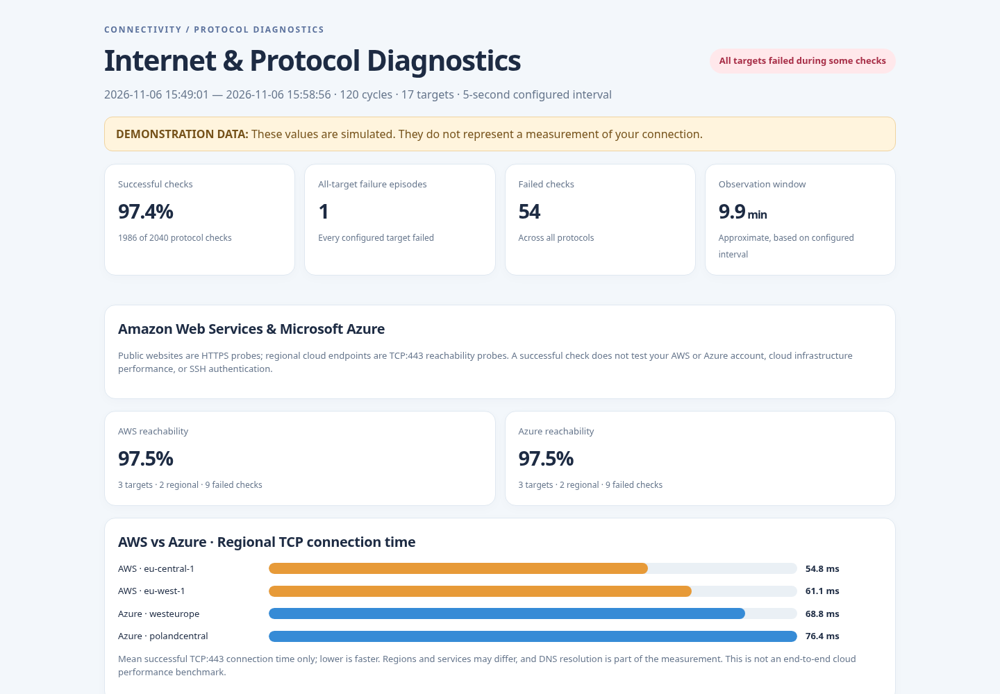
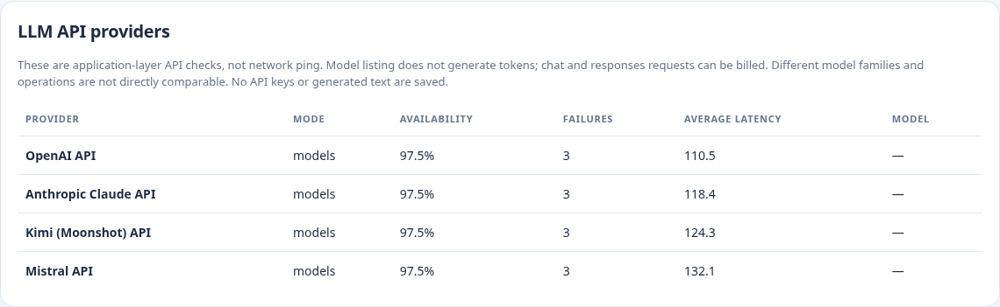

# ISP Cloud & LLM Monitor

**Network diagnostics, cloud reachability, and LLM API availability — in one Python CLI with a visual HTML dashboard.**

[](#development-and-testing)   

> **Important:** The screenshots and bundled sample report use **simulated demonstration data**. No live network measurements are represented. You must run the monitor on your own computer/network for real measurements.



## What it does

- **ISP diagnostics:** TCP connection checks, DNS queries, ICMP echo, SSH identification-banner checks, HTTP and HTTPS endpoint checks.
- **Cloud reachability:** public AWS/Azure websites, plus configurable regional AWS S3 and Azure Monitor TCP:443 endpoints.
- **LLM API monitoring:** OpenAI, Anthropic Claude, Kimi (Moonshot), and Mistral; provider-specific authentication headers, model-listing checks, and optional inference tests.
- **Reporting:** a self-contained, offline **HTML dashboard** and machine-readable **CSV** with per-target success/failure, latency, error details, cloud and LLM summaries.
- **Local-first operation:** core diagnostics use only the Python standard library. `speedtest-cli` is optional for download/upload measurements.
- **Cross-platform:** Python 3.9+ on Windows, Linux, or macOS; Windows `.cmd` launchers included.

### LLM provider report



The report is generated by `provider_monitor.py`. Open [the included example report](sample_report_4llm.html) in a browser to inspect the layout without API keys.

## LLM index, model catalog, and AI bots

The repository now includes an **LLM-readable project index** and a documented **bot/crawler index**. They are intentionally separate from API monitoring:

- [`llms.txt`](llms.txt) — concise Markdown links for AI assistants reading the project (a voluntary emerging convention, not a guarantee of search indexing).
- [`llms-full.txt`](llms-full.txt) — optional expanded context for automated readers.
- [`docs/LLM_INDEX.md`](docs/LLM_INDEX.md) — reference of the four supported API providers and instructions to create a private model-ID catalog.
- [`docs/LLM_USAGE.md`](docs/LLM_USAGE.md) — step-by-step real API usage (keys, model checks, inference, troubleshooting).
- [`docs/AI_BOT_INDEX.md`](docs/AI_BOT_INDEX.md) — known OpenAI/Anthropic crawler identifiers and Google-Extended, with official references.
- [`llm_index.json`](llm_index.json) — machine-readable public API/crawler directory, generated from source; contains **no API keys**.
- [`robots.txt`](robots.txt) — **example** website-root crawler policy, not an instruction that GitHub itself follows for your repository.
- [`AGENTS.md`](AGENTS.md) — guidelines for coding assistants working on this repository.

List built-in LLM API providers (offline):

```bash
python provider_monitor.py --list-llm-providers
```

Generate an account-specific model-ID list using authenticated `GET /models` without generating text:

```bash
python scripts/fetch_model_index.py --all-providers --env-file api_keys.env
```

`model_index.json` is private/local and gitignored. APIs may paginate; the indexer flags partial inventories. For bot indexing on a site you control, publish `llms.txt` and an appropriate `robots.txt` at the site root. A file committed to a GitHub repository does **not** control GitHub's robots policy.

## Quick start

1. Install **Python 3.9 or newer** and download/clone this repository.
2. Open a terminal in the repository directory.
3. Generate a **demo report without internet access or API keys**:

```bash
python provider_monitor.py --all-tests --llm-all-providers --demo --output demo_report.html
```

4. Open `demo_report.html` in your web browser. The matching CSV is `demo_report.csv`.

On **Windows**, you can instead double-click `RUN_DEMO_WINDOWS.cmd`.

## Real monitoring

### All standard network + AWS/Azure checks

```bash
python provider_monitor.py --all-tests --minutes 30 --interval 30 --timeout 4
```

`--all-tests` enables the built-in TCP, HTTP(S), DNS, ICMP, and AWS/Azure cloud checks and runs an optional speed test at the end (if `speedtest-cli` is installed). The program writes `provider_report.html` and `provider_report.csv` by default.

To install optional throughput testing:

```bash
python -m pip install speedtest-cli
```

### Configure LLM API keys

Copy the placeholder file and replace the values with **your own keys**:

**Windows PowerShell**

```powershell
Copy-Item api_keys.env.example api_keys.env
notepad api_keys.env
```

**Linux / macOS**

```bash
cp api_keys.env.example api_keys.env
# Edit api_keys.env locally in your text editor.
```

The monitor reads keys from the local `api_keys.env` file with `--env-file`, or from environment variables directly:

| Provider | Environment variable | API check modes |
|---|---|---|
| OpenAI | `OPENAI_API_KEY` | `models`, `chat`, `responses` |
| Anthropic Claude | `ANTHROPIC_API_KEY` | `models`, `chat` (native Messages API) |
| Kimi / Moonshot | `KIMI_API_KEY` | `models`, `chat` |
| Mistral | `MISTRAL_API_KEY` | `models`, `chat` |

**Do not commit `api_keys.env` or paste keys into GitHub issues.** The repository `.gitignore` excludes that file. Never embed a real key in a URL or screenshot. For `models` checks, the monitor does not request generated text; inference modes can incur usage charges.

Run the **full network + cloud + four-LLM API** suite:

```bash
python provider_monitor.py --all-tests --llm-all-providers --llm-mode models --env-file api_keys.env --minutes 10 --interval 60 --llm-timeout 15
```

On Windows, `RUN_ALL_LIVE_WINDOWS.cmd` performs a similar models-only monitoring run after you create `api_keys.env`.

### Test a specific LLM provider

```bash
python provider_monitor.py --no-default-targets --llm-provider anthropic --llm-mode models --env-file api_keys.env --minutes 5 --interval 30
```

To test inference, supply the provider's actual model identifier, for example:

```bash
python provider_monitor.py --no-default-targets --llm-provider mistral --llm-mode chat --mistral-model YOUR_MODEL_ID --env-file api_keys.env --minutes 2 --interval 30
```

Replace `YOUR_MODEL_ID` with a valid model available to your account. `--llm-mode responses` is for the generic OpenAI-compatible Responses API target; other built-in providers use their supported endpoints.

### SSH and custom protocol targets

```bash
python provider_monitor.py --minutes 10 --interval 5 --ssh-host 192.168.1.20 --ssh-port 22
```

```bash
python provider_monitor.py --no-default-targets \
  --target "SSH gateway=ssh://192.168.1.20:22" \
  --target "My website=https://example.com/" \
  --target "DNS resolver=dns://1.1.1.1/example.com" \
  --target "ICMP echo=icmp://8.8.8.8"
```

On PowerShell, use one line or replace trailing `\` with PowerShell backticks. SSH checks server identity/banner reachability, **not a successful SSH login**.

### Test AWS and Azure regions

```bash
python provider_monitor.py --cloud-only --aws-region eu-central-1 --aws-region eu-west-1 --azure-region westeurope --azure-region polandcentral --minutes 10
```

Run `python provider_monitor.py --list-cloud-regions` to see supported presets.

## Reports and interpretation

| Output | Contents |
|---|---|
| `provider_report.html` | Self-contained dashboard with availability metrics, latency visualizations, cloud comparisons, LLM stats, target summaries and failure episodes |
| `provider_report.csv` | Row-by-row observations with timestamps, target/protocol, timing and errors |
| `sample_report_4llm.html` | Bundled **simulated** example for preview |

**Interpret the measurements carefully:** TCP connect times, ICMP ping times, HTTPS application response times, and LLM API request times are different metrics. Public AWS/Azure endpoints establish reachability, **not** benchmark performance for an AWS EC2 VM or an Azure VM. An unavailable public endpoint is **not** proof that your ISP is at fault. Wi-Fi instability, local routers, DNS, routing, remote service errors, API rate limits, and authentication problems can all affect results.

For a fair ISP diagnosis, use a wired Ethernet connection and multiple independent targets. Avoid repeatedly invoking inference endpoints at short intervals because this can consume API quota and cost money.

## Project structure

```text
isp-cloud-llm-monitor/
├── provider_monitor.py          # Monitor and report generator
├── api_keys.env.example         # Placeholder configuration (safe to commit)
├── RUN_DEMO_WINDOWS.cmd         # Demo dashboard, no network calls
├── RUN_ALL_LIVE_WINDOWS.cmd     # Live checks using local keys
├── sample_report_4llm.html     # Simulated sample report
├── sample_report_4llm.csv      # Simulated sample data
├── assets/
│   ├── dashboard-screenshot.png
│   └── llm-providers-screenshot.png
├── docs/
│   ├── LLM_INDEX.md             # LLM provider catalog and model discovery
│   ├── LLM_USAGE.md             # LLM API tutorials and example commands
│   └── AI_BOT_INDEX.md          # Search/training/user AI bot directory
├── scripts/
│   ├── build_llm_index.py      # Regenerates the public JSON index
│   └── fetch_model_index.py    # Builds private model ID inventory
├── llm_index.json             # API providers + AI bot tokens (no secrets)
├── llms.txt                   # Short index for LLM readers
├── llms-full.txt              # Optional expanded LLM-readable reference
├── robots.txt                 # Example site-root crawler policy
├── AGENTS.md                  # Instructions for coding agents
├── tests/test_index.py         # Offline indexing tests
├── tests/test_smoke.py          # Offline test suite
├── .github/workflows/ci.yml    # Python test workflow
├── REPOSITORY_DETAILS.md       # GitHub title/description/topics and publishing guide
├── LICENSE
└── README.md
```

## Development and testing

```bash
python -m unittest discover -s tests -v
python -m py_compile provider_monitor.py
python provider_monitor.py --help
```

The smoke tests use demo mode and do not make network calls. Live cloud-provider and LLM-authentication checks depend on actual network connectivity and account credentials; they are **not covered by offline smoke tests**.

## Security

- Keep API keys and all credential files private. `.gitignore` excludes `api_keys.env` and `.env` files.
- Reports may contain hostnames, IP addresses, URL paths, and service errors. Review before sharing publicly.
- Custom targets should be endpoints you operate or are authorized to monitor.
- See [SECURITY.md](SECURITY.md) for disclosure guidance.

## License

MIT — see [LICENSE](LICENSE).


### GitHub Actions compatibility (Ubuntu 26.04)

The CI workflow tests Python **3.9 on `ubuntu-24.04`**, and **3.11 / 3.13 on `ubuntu-latest`**. GitHub began transitioning `ubuntu-latest` to Ubuntu 26.04 in October 2026, and `actions/setup-python` does not provide Python 3.9 builds for Ubuntu 26.04. Using an explicit OS for the Python 3.9 job avoids setup failures. The workflow uses `actions/checkout@v7` and `actions/setup-python@v7`. See [`docs/CI_TROUBLESHOOTING.md`](docs/CI_TROUBLESHOOTING.md) for details.
